<div align="center">

# 🏥 Alexa+ LifeOps

### Autonomous Care Assistant — Voice-First Health Agent

[](https://developer.amazon.com/alexa)
[](https://aws.amazon.com/bedrock/)
[](LICENSE)

**Alexa+ LifeOps** is an autonomous health-care agent that transforms Amazon Echo Show into a proactive clinical assistant. It uses **MCP Streamable HTTP** for tool orchestration and **AWS Bedrock Converse** for intelligent agentic reasoning — analyzing vitals, scheduling medications, retrieving patient profiles, and triggering emergency protocols via natural voice conversation.

*Built for the Amazon Developer — Build, Ship, Shape Hackathon 2026.*

---

</div>

## ✨ Features

| Feature | Description |
|---|---|
| 🫀 **Vitals Analysis** | Real-time BP / Heart Rate / SpO₂ analysis with risk-level classification (Normal → Warning → Critical) and clinical guidance. |
| 💊 **Medication Scheduling** | Natural-language care action scheduling with configurable reminders ("Schedule Metformin at 8 PM tonight"). |
| 🚨 **Emergency Protocol** | Automatic EMS dispatch, caregiver SMS alerts, and local alarm activation on detecting critical symptoms. |
| 👤 **Patient Profile** | Instant retrieval of demographics, allergies, active medications, and emergency contacts. |
| 🗣️ **Voice I/O** | Full speech-to-text input (Web Speech API) + text-to-speech Alexa voice output with Chromium GC workarounds. |
| 🔍 **MCP Inspector** | Built-in Streamable HTTP protocol inspector showing live tool calls, payloads, and timing. |
| 🧠 **Bedrock Agentic Loop** | Multi-turn Converse API orchestration with automatic `toolUse` → `toolResult` cycling. |
| 🔄 **Offline Capable** | Works fully offline — the built-in rule-based clinical evaluator invokes the same MCP tools when Bedrock is unavailable. |

---

## 🏗️ Architecture

```mermaid
graph LR
    A["👤 User<br/>(Voice / Text)"] --> B["📱 Echo Show UI<br/>(Browser)"]
    B -->|"POST /api/alexa/interact"| C["⚡ FastAPI Gateway<br/>(server.py)"]
    C -->|"Bedrock Converse"| D["🧠 Agent Orchestrator<br/>(agent.py)"]
    D -->|"toolUse dispatch"| E["🔧 MCP Tool Server<br/>(tools.py)"]
    E -->|"toolResult"| D
    D -->|"alexa_speech + cards"| C
    C -->|"JSON Response"| B

    style A fill:#0f172a,stroke:#00CAFF,color:#e2e8f0
    style B fill:#0f172a,stroke:#00CAFF,color:#e2e8f0
    style C fill:#0f172a,stroke:#f59e0b,color:#e2e8f0
    style D fill:#0f172a,stroke:#8b5cf6,color:#e2e8f0
    style E fill:#0f172a,stroke:#22c55e,color:#e2e8f0
```



**Data Flow:**
1. User speaks or types a health query on the Echo Show UI.
2. FastAPI gateway forwards the prompt to the Bedrock Converse orchestrator.
3. Bedrock Converse reasons over the query and emits `toolUse` requests.
4. MCP tools execute deterministically (vitals analysis, scheduling, emergency dispatch).
5. `toolResult` feeds back into the Converse loop until the model produces a final natural-language response.
6. UI renders the Alexa speech bubble, dynamic cards, and TTS voice output simultaneously.

---

## 🚀 Quickstart

### Prerequisites
- Python 3.10+
- AWS credentials configured (optional — falls back to local rule-based engine)

### Run Locally in 3 Commands

```bash
# 1. Install dependencies
pip install -r requirements.txt

# 2. (Optional) Configure AWS Bedrock credentials
export AWS_ACCESS_KEY_ID=your_key
export AWS_SECRET_ACCESS_KEY=your_secret
export AWS_DEFAULT_REGION=us-east-1

# 3. Launch the server
python server.py
```

Open **http://localhost:8000** in your browser → Echo Show UI + MCP Inspector ready.

> **No AWS credentials?** No problem. The agent seamlessly switches to the built-in rule-based clinical evaluator — all MCP tools work identically.

---

## 📁 Project Structure

```
alexa-plus-lifeops/
├── server.py           # FastAPI gateway — MCP Streamable HTTP + Alexa endpoints
├── agent.py            # Bedrock Converse orchestrator + rule-based clinical evaluator
├── tools.py            # MCP tool implementations (vitals, scheduling, emergency, profile)
├── requirements.txt    # Python dependencies
├── static/
│   └── index.html      # Echo Show simulator UI + MCP Inspector + TTS voice
├── LICENSE             # MIT License
├── FRICTION_LOG.md     # Developer friction log (10% bonus)
└── README.md           # This file
```

---

## 🛠️ MCP Tool Manifest & Endpoints

The server exposes 4 clinical tools via the MCP Streamable HTTP protocol (`/mcp` and legacy `/mcp/v1/*`):

| Tool | Parameters | Description |
|---|---|---|
| `analyze_vitals` | `systolic`, `diastolic`, `heart_rate`, `sp_o2` | Analyze BP, HR, SpO₂ with risk classification |
| `schedule_care_action` | `action_type`, `details`, `schedule_time` | Schedule medication reminders and care actions |
| `trigger_emergency_protocol` | `reason`, `patient_location` | Activate EMS dispatch + caregiver alerts |
| `get_patient_profile` | `patient_id` | Retrieve patient demographics, medications, allergies |

**Protocol:** `MCP v2025-11-25 · Streamable HTTP · JSON-RPC 2.0`  
**JSON-RPC Endpoint:** `POST /mcp`  
**REST Manifest:** `GET /mcp/v1/tools`

### Official MCP JSON-RPC 2.0 Testing (`/mcp`)

#### 1. Handshake (`initialize`)
```bash
curl -X POST http://localhost:8000/mcp \
  -H "Content-Type: application/json" \
  -d '{
    "jsonrpc": "2.0",
    "id": 1,
    "method": "initialize"
  }'
```

#### 2. Discover Tools (`tools/list`)
```bash
curl -X POST http://localhost:8000/mcp \
  -H "Content-Type: application/json" \
  -d '{
    "jsonrpc": "2.0",
    "id": 2,
    "method": "tools/list"
  }'
```

#### 3. Execute Tool (`tools/call`)
```bash
curl -X POST http://localhost:8000/mcp \
  -H "Content-Type: application/json" \
  -d '{
    "jsonrpc": "2.0",
    "id": 3,
    "method": "tools/call",
    "params": {
      "name": "analyze_vitals",
      "arguments": {
        "systolic": 140,
        "diastolic": 90,
        "heart_rate": 95,
        "sp_o2": 97
      }
    }
  }'
```

---

## 🏆 Hackathon Track Alignment

| Track | Status | Details |
|---|---|---|
| ✅ **Alexa+ Track** | Qualified | MCP Streamable HTTP server with tool manifest, multi-tool orchestration, Echo Show simulated UI |
| ✅ **AWS Builder Challenge** | Qualified | Bedrock Converse API with agentic `toolUse` / `toolResult` loop |
| ✅ **Open Source Mini Challenge** | Qualified | MIT License — fully open source |
| ✅ **10% Friction Log Bonus** | Qualified | Comprehensive [FRICTION_LOG.md](FRICTION_LOG.md) with structured feedback on MCP Streamable HTTP chunked response buffering and Bedrock Converse schema strictness |

---

## 📄 License

This project is licensed under the **MIT License** — see the [LICENSE](LICENSE) file for details.

Copyright (c) 2026 Shashwat Pandey

---

<div align="center">

**Built with ❤️ for the Amazon Developer — Build, Ship, Shape Hackathon 2026**

*Alexa+ LifeOps — Because health care should be voice-first, intelligent, and always available.*

</div>

---
### ⚠️ Medical & Simulation Disclaimer
Alexa+ LifeOps is a simulated concept demonstration built exclusively for the Amazon Developer — Build, Ship, Shape Hackathon 2026. It is NOT a certified medical device and is NOT intended for primary clinical diagnosis, critical patient monitoring, or real-world emergency dispatch. All triage outcomes, reminders, and alerts are simulated locally.
