<div align="center">

# Alexa+ LifeOps

### Autonomous Care Assistant - Voice-First Health Agent

[](https://developer.amazon.com/alexa)
[](https://aws.amazon.com/bedrock/)
[](LICENSE)

**Alexa+ LifeOps** is an autonomous care agent concept that models an Amazon Echo Show proactive assistant. It uses the **MCP 2025-11-25 Streamable HTTP transport** for tool orchestration and **AWS Bedrock Converse** for multi-turn agentic reasoning - analyzing vitals, scheduling medication reminders, retrieving patient profiles, and triggering simulated emergency protocols via voice conversation.

*Built for the Amazon Developer - Build, Ship, Shape Hackathon 2026.*

---

</div>

## Alexa+ Track Note
Alexa+ LifeOps demonstrates an **MCP server over Streamable HTTP** coupled with an **Echo Show simulator companion UI**. The core service exposes a standards-compliant JSON-RPC 2.0 endpoint at `POST /mcp` that any standard MCP client can discover and execute against.

---

## Features

| Feature | Description |
|---|---|
| **Vitals Analysis** | Spot BP, Heart Rate, and SpO2 analysis with AHA/ACC guidelines-based risk-level classification. |
| **Medication Scheduling** | Natural-language care action scheduling with relative time parsing ("tomorrow at 8 PM"). |
| **Simulated Emergency Protocol** | Multi-channel escalation (simulated 911 dispatch, caregiver alert, local alarm). |
| **Patient Profile** | Baseline retrieval of demographics, allergies, active medications, and emergency contacts. |
| **Voice & Visual Interaction** | Web Speech API speech-to-text input, Alexa voice synthesis, and dynamic care cards. |
| **Multi-Turn Bedrock Loop** | Bedrock Converse loop that processes multiple sequential tool requests in a turn. |
| **Rule-Based Fallback** | Deterministic local clinical evaluator that runs offline when AWS credentials are absent. |

---

## Architecture

```mermaid
graph LR
    A["User<br/>(Voice / Text)"] --> B["Echo Show UI<br/>(Browser)"]
    B -->|"POST /api/alexa/interact"| C["FastAPI Gateway<br/>(server.py)"]
    C -->|"Bedrock Converse"| D["Agent Orchestrator<br/>(agent.py)"]
    D -->|"dispatch_tool()"| E["MCP Tools<br/>(tools.py)"]
    E -->|"tool result"| D
    D -->|"alexa_speech + cards"| C
    C -->|"JSON Response"| B

    style A fill:#0f172a,stroke:#00CAFF,color:#e2e8f0
    style B fill:#0f172a,stroke:#00CAFF,color:#e2e8f0
    style C fill:#0f172a,stroke:#f59e0b,color:#e2e8f0
    style D fill:#0f172a,stroke:#8b5cf6,color:#e2e8f0
    style E fill:#0f172a,stroke:#22c55e,color:#e2e8f0
```



---

## Quickstart

### Prerequisites
- Python 3.10+
- AWS credentials configured (optional; falls back to local rule-based engine)

### Run Locally

```bash
# 1. Install dependencies
pip install -r requirements.txt

# 2. (Optional) Configure AWS Bedrock credentials
export AWS_ACCESS_KEY_ID=your_key
export AWS_SECRET_ACCESS_KEY=your_secret
export AWS_DEFAULT_REGION=us-east-1
export BEDROCK_MODEL_ID=anthropic.claude-3-5-sonnet-20240620-v1:0

# 3. Launch server (binds to 127.0.0.1:8000 by default)
python server.py
```

Open **http://localhost:8000** in your browser to view the Echo Show companion interface.

---

## Project Structure

```
alexa-plus-lifeops/
|-- server.py           # FastAPI gateway - POST /mcp (JSON-RPC 2.0) + Alexa endpoints
|-- agent.py            # Bedrock Converse multi-turn orchestrator + rule-based evaluator
|-- tools.py            # MCP tool definitions, schemas, and shared dispatcher
|-- requirements.txt    # Pinned Python dependencies
|-- static/
|   \-- index.html      # Echo Show simulator companion UI + voice synthesis
|-- LICENSE             # MIT License
|-- FRICTION_LOG.md     # Developer feedback report
\-- README.md           # Project documentation
```

---

## Official MCP Endpoint (`POST /mcp`)

The primary integration interface is **`POST /mcp`**, implementing the **Model Context Protocol 2025-11-25 Streamable HTTP transport**.

Supported JSON-RPC 2.0 methods:
- `initialize`: Protocol negotiation, returns server capabilities and metadata.
- `notifications/initialized`: Notification handshake, returns `202 Accepted` with empty body.
- `ping`: Liveness check, returns `{}`.
- `tools/list`: Returns schemas for all 4 clinical tools.
- `tools/call`: Executes a tool by name, returning text and structured content with `isError: false`.

> **Note on `/mcp/v1/*` routes**: The `/mcp/v1/tools` and `/mcp/v1/tools/call` endpoints are legacy REST helper routes preserved for backward compatibility with the bundled Echo Show UI.

### Official MCP JSON-RPC 2.0 Testing (`/mcp`)

#### 1. Handshake (`initialize`)
```bash
curl -X POST http://localhost:8000/mcp \
  -H "Content-Type: application/json" \
  -H "Accept: application/json, text/event-stream" \
  -d '{
    "jsonrpc": "2.0",
    "id": 1,
    "method": "initialize"
  }'
```

#### 2. Notification Handshake (`notifications/initialized`)
```bash
curl -X POST http://localhost:8000/mcp \
  -H "Content-Type: application/json" \
  -H "Accept: application/json, text/event-stream" \
  -d '{
    "jsonrpc": "2.0",
    "method": "notifications/initialized"
  }'
```
*(Returns `HTTP 202 Accepted` with empty body)*

#### 3. Ping (`ping`)
```bash
curl -X POST http://localhost:8000/mcp \
  -H "Content-Type: application/json" \
  -H "Accept: application/json, text/event-stream" \
  -d '{
    "jsonrpc": "2.0",
    "id": 2,
    "method": "ping"
  }'
```

#### 4. Discover Tools (`tools/list`)
```bash
curl -X POST http://localhost:8000/mcp \
  -H "Content-Type: application/json" \
  -H "Accept: application/json, text/event-stream" \
  -d '{
    "jsonrpc": "2.0",
    "id": 3,
    "method": "tools/list"
  }'
```

#### 5. Execute Tool (`tools/call`)
```bash
curl -X POST http://localhost:8000/mcp \
  -H "Content-Type: application/json" \
  -H "Accept: application/json, text/event-stream" \
  -d '{
    "jsonrpc": "2.0",
    "id": 4,
    "method": "tools/call",
    "params": {
      "name": "analyze_vitals",
      "arguments": {
        "systolic": 140,
        "diastolic": 90,
        "heart_rate": 95
      }
    }
  }'
```

---

## Testing with the Official MCP Inspector

You can connect and test Alexa+ LifeOps with the official Model Context Protocol Inspector:

```bash
npx @modelcontextprotocol/inspector
```

1. Open the inspector web interface (e.g. `http://localhost:5173`).
2. Select Transport: **Streamable HTTP**.
3. Set Server URL: `http://localhost:8000/mcp`.
4. Click **Connect** to inspect tool schemas and execute live calls.

---

## Hackathon Track Summary

| Track | Implementation Summary |
|---|---|
| **Alexa+ Track** | MCP server over Streamable HTTP (`POST /mcp`, 2025-11-25) + Echo Show simulator UI. |
| **AWS Builder Challenge** | AWS Bedrock Converse API integration with multi-turn `toolUse`/`toolResult` loop and deterministic local fallback. |
| **Open Source Mini Challenge** | Open-source project published under the standard MIT License. |
| **Developer Friction Log** | Structured feedback report in [FRICTION_LOG.md](FRICTION_LOG.md) documenting technical friction with Streamable HTTP and Converse schemas. |

---

## Limitations / Disclaimer

> **Demo Only - Not a Medical Device**
> 
> Alexa+ LifeOps is a prototype simulation built for the Amazon Developer - Build, Ship, Shape Hackathon 2026.
> - **No Real Emergency Dispatch**: Emergency actions, EMS dispatch alerts, and SMS notifications are simulated locally. No emergency services (911 or otherwise) are contacted.
> - **Not Diagnostic**: Risk assessments and triage outputs are for demonstration only and should not replace licensed clinical care.
> - **Local Demo Environment**: The local development server does not enforce authentication or encryption; it is intended for local inspection (`127.0.0.1`).
> - **Rule-Based Fallback**: When AWS Bedrock credentials are unavailable, the agent falls back to a deterministic rule-based clinical engine.

---

## License

This project is licensed under the **MIT License** - see the [LICENSE](LICENSE) file for details.

Copyright (c) 2026 Shashwat Pandey
